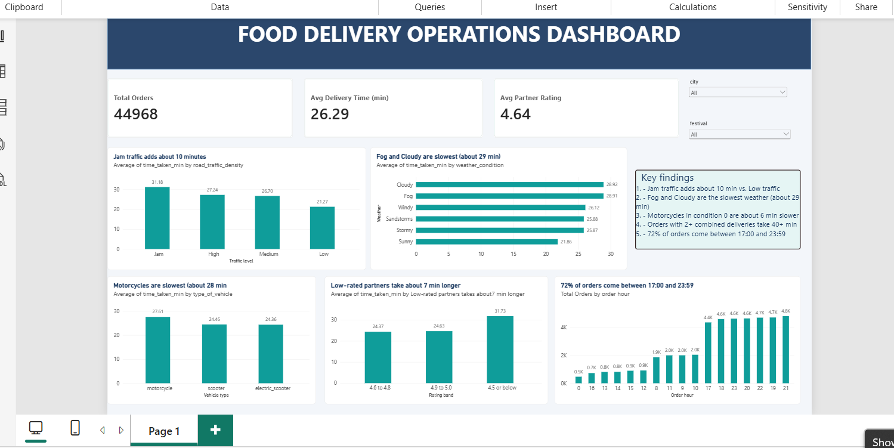

 Food Delivery Operations Analysis

Analysis of **44,968 food delivery orders** to find out what slows deliveries down. Cleaned with pandas, analyzed in MySQL, and presented in a Power BI dashboard.

**Data:** Kaggle food delivery dataset | **Tools:** Python (pandas, Matplotlib), MySQL, Power BI

## Key Findings

- **Traffic:** Jam takes about 31 min vs. 21 min in Low traffic. About 34% of Jam orders take over 35 min, vs. 4% in Low traffic.
- **Weather:** Fog and Cloudy are slowest (about 29 min), Sunny is fastest (about 22 min).
- **Vehicle:** Motorcycles in poor condition (condition 0) take about 30 min vs. about 24 min for all other vehicles.
- **Partner ratings:** Partners rated 4.5 or below take about 7 minutes longer.
- **Peak hours:** 72% of orders come between 17:00 and 23:59, and 19:00 to 21:59 is the slowest.
- **Order type** has no effect on delivery time (all about 26 min).

## Recommendations

1. Add partners and show realistic delivery times during traffic jams and the 19:00 to 21:59 peak.
2. Limit partners to one combined order at a time (orders with 2 or more combined deliveries take 41 to 48 min).
3. Inspect and repair motorcycles in condition 0, and coach low-rated partners.

## Data Cleaning

45,584 rows and 20 columns became 44,968 rows and 15 columns, with 0 missing values. Main steps: fixed mixed date and time formats, removed impossible ages (under 18) and ratings (above 5), filled missing values with the median or "Unknown", corrected the city typo, and dropped 616 incomplete rows. Full steps and the cleaning log are in the notebook.

## SQL

16 business questions with insights and recommendations, using `GROUP BY`, `HAVING`, `CASE WHEN`, a CTE, and window functions (`RANK`, `ROW_NUMBER`).

## Files

| File | Description |
|---|---|
| `food_delivery_cleaning.ipynb` | Cleaning steps, cleaning log and charts (pandas) |
| `food_delivery_clean.csv` | Cleaned dataset |
| `food_delivery_analysis.sql` | MySQL business questions |
| `food_delivery_dashboard.pbix` | Power BI dashboard |
| `images/` | Dashboard screenshot and charts |

**Note:** the bicycle vehicle type is not in the analysis, because all 68 bicycle orders were incomplete records and were dropped during cleaning.

